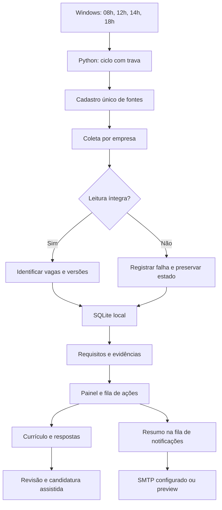

# Roadmap executável do JOBOS local

## Direção do produto

Quero abrir o painel e entender: quais fontes funcionaram; quais vagas surgiram ou mudaram; quais merecem meu tempo; qual currículo foi preparado; onde parei na candidatura; e o que foi enviado de verdade. O sistema continua útil se SMTP ou IA estiverem indisponíveis.

Inicialmente todo o estado mora neste PC. Python organiza o trabalho, SQLite guarda o histórico e o painel local consulta a mesma base. O agendamento é do Windows, não de uma conversa com IA. O Claude Code implementa e mantém o projeto; não precisa estar aberto para cada coleta.

## Fluxo principal

## Ordem e marcos

| Fase | Entrega | Depende de | Critério para avançar |
|---|---|---|---|
| P0 | Inventário, cópias de segurança e decisão de reaproveitamento | Anexos e disco real | Dados existentes identificados; nenhum código legado executado às cegas |
| P1 | Núcleo, migração e semântica correta | P0 | Importar duas vezes não duplica; nenhuma sugestão vira candidatura |
| P2 | Coleta confiável e mudanças | P1 | Falhas, paginação e desaparecimentos tratados por fonte |
| P3 | Painel local e histórico editável | P1/P2 | Navegador e CLI mostram os mesmos estados |
| P4 | Compatibilidade baseada em evidências | P2/P3 | Requisitos, lacunas e incertezas visíveis; sem porcentagem de contratação |
| P5 | Notificações e agendamento Windows | P2/P3; P4 melhora o conteúdo | Execução agendada real e preview auditáveis; envio configurável |
| P6 | Currículo por vaga e PDF | P4; contrato real do CV Builder | Fatos rastreáveis e PDF inspecionado |
| P7 | Preenchimento assistido por ATS | P6 e sessão do usuário | Prova em formulário de teste; envio final desativado por padrão |
| P8 | Exportações e publicação opcional | P3 e contratos de ownership | Local continua funcionando se integração cair |
| P9 | Operação acompanhada e melhoria | P0 a P5 | Vários dias de evidências reais, falhas visíveis e restore comprovado |

As fases definem dependências, não estimativas artificiais de horas. Registrar tempo real e bloqueios encontrados. Começar P0 a P3 na primeira execução e continuar enquanto houver contexto e verificações concluídas. Não iniciar um novo ciclo de planejamento ao terminar P0.

## P0: conhecer e preservar o projeto real

### Tarefas

1. Ler instruções locais aplicáveis (`AGENTS.md`, `CLAUDE.md` e regras do repositório). Este blueprint não autoriza ignorar políticas de acesso do ambiente.
2. Confirmar a raiz Windows. Verificar se Claude está nativo no Windows ou em WSL. No WSL, resolver a raiz por `wslpath`; não misturar `python.exe`, `.venv` Linux e Playwright de outro sistema.
3. Listar arquivos com `rg --files`, incluindo os ZIPs informados. Não percorrer todo o disco nem imprimir credenciais.
4. Identificar se `Artifact.zip` já foi extraído ou modificado. Comparar por hash os arquivos iguais; preservar versões divergentes. O disco real tem prioridade sobre suposições sobre sua organização.
5. Inspecionar código e dependências antes de instalar ou rodar. O README do legado contém afirmações de testes antigos que não provam funcionamento atual.
6. Inventariar Python, Node, runtimes TS, Git e portas livres. Reaproveitar versões compatíveis; não exigir serviços pagos.
7. Inspecionar `jobs.db` em modo somente leitura. Capturar esquema, contagens, integridade, estados e procedência. Não assumir que o DB local tem as mesmas contagens do anexo.
8. Fazer backup consistente de bancos via API SQLite. Para arquivos legados fechados pode haver cópia binária; para banco ativo não copiar só o `.db` ignorando WAL.
9. Registrar os cadastros de empresa e leitor disponíveis em Python e TS. Montar uma matriz de cobertura das 28 empresas do JSON e de todas as empresas extras do YAML.
10. Identificar regras antigas de salário, localização, exclusão de empregadores e pontuação. Importar como políticas legadas com origem visível, não como novos fatos pessoais.
11. Verificar se a árvore `__VAGAS` é publicada/sincronizada. Preparar exclusões e uma lista explícita de diretórios estáticos permitidos.

### Entregas

`docs/AUDIT.md`, `docs/SOURCE-COVERAGE.md`, `docs/REUSE-MAP.md`, `docs/CONFLICTS.md`, `docs/DECISIONS.md`, `docs/PROGRESS.md` e `data/imports/<import_id>/manifest.json`.

### Critério de conclusão

Mapa indicando por arquivo: reutilizar, adaptar, substituir, manter como referência ou desativar. Backups legíveis. Nenhum SMTP, ATS, WordPress ou script de sincronização executado durante o inventário.

## P1: uma base consistente

### Tarefas

1. Montar pacote Python em `_system/src/jobos` com `pyproject.toml` e instalação editável no `.venv`. Evitar colisão com um pacote `jobos` antigo no diretório de execução.
2. Centralizar caminhos absolutos a partir da raiz configurada. Nenhum código deve depender do diretório corrente ou de uma unidade inventada.
3. Criar CLI `python -m jobos` com parser estrito. Uma flag desconhecida deve falhar, nunca transformar um preview em envio real.
4. Introduzir migrações versionadas e uma base canônica em `_system/data/jobos.sqlite3`. Ler a base legada sem alterá-la; importar e manter mapa de IDs.
5. Importar `jobs.json` como fotografia histórica e o SQLite legado como histórico operacional. Identificar sobreposições por referências fortes e conservar possíveis duplicatas para revisão.
6. Preservar eventos, notas, versões de CV, datas, decisões e campos desconhecidos em payload legado. Nenhuma coluna importante deve desaparecer silenciosamente.
7. Separar estado de anúncio, preparação de candidatura, procedência e estágio seletivo. Uma vaga fechada pode ter entrevista em andamento.
8. Desativar `consolidar_pendentes()` e todos os caminhos indiretos que marcam aplicada pela passagem do tempo ou envio de boletim.
9. Migrar `auto_sugerida` para `legacy_needs_review`, mantendo valor original e trilha de migração. Registros aplicados sem procedência recebem a mesma classificação de revisão. Não apagar nem declarar falsos automaticamente.
10. Separar datas reais, datas detectadas, datas estimadas e importação. Uma data histórica desconhecida deve continuar desconhecida.
11. Carregar o JSON profissional completo como perfil local versionado. Gerar projeções para os módulos antigos, se necessário; não editar várias cópias à mão.

### Critério de conclusão

Importação idempotente, foreign keys válidas, integridade SQLite OK, relatórios antes/depois e zero novas candidaturas produzidas pela migração. O processo roda com `doctor`, `import-legacy`, `status` e `backup`, mesmo sem internet.

## P2: coletar com confiança

### Estratégia de reutilização

Python já tem leitores para várias fontes. O TS adiciona implementações úteis e precisa ser aproveitado onde oferece cobertura melhor. Não chamar `refreshJobs()` cegamente como fonte canônica: ele também mescla e encerra vagas no JSON.

Criar uma interface comum de resultado de coleta. Para cada fonte, selecionar UM leitor principal. Outro leitor pode ser fallback explícito, com proveniência; ambos nunca gravam estado operacional por conta própria.

Se o leitor TS for escolhido, um bridge de coleta chama `collectCompany()` ou função de extração equivalente e emite NDJSON validado. Logs vão para stderr. Python chama o processo com lista de argumentos, `shell=False`, cwd explícito, timeout, cancelamento e caminho de runtime verificado. Não presumir que qualquer `node arquivo.ts` funciona; testar a toolchain existente ou configurar TS compilado/runner local com lockfile.

### Tarefas

- Unificar o cadastro de fontes com URLs, tenants, filtros, leitor, paginação, limites e evidência da configuração.
- Implementar timeout por requisição, limite por fonte, retry com atraso exponencial e jitter para falhas transitórias. Respeitar `Retry-After`; 401/403 não disparam troca de identidade nem tentativa infinita.
- Registrar paginação esperada/recebida e status de completude. Chegar a um limite artificial de páginas não conta como coleta completa.
- Registrar escopo/filtros da coleta. Resultado completo de query incremental não representa o quadro inteiro e não autoriza fechamento fora daquele escopo. Nova fonte começa por baseline, sem alertar todo estoque antigo como lançamento.
- Tratar HTTP 200 com tela de login, desafio, HTML inesperado ou array incompatível como erro de formato, não como zero vagas.
- Extrair descrição completa, requisitos, responsabilidades, qualificações, regime, remuneração e localização quando publicados. Campos ausentes ficam desconhecidos.
- Priorizar detalhes de vagas novas/alteradas e revalidar as demais por TTL. Evitar abrir centenas de páginas iguais em todos os ciclos.
- Comparar conteúdo significativo e gerar versões. Atualizar descrição alterada de vaga conhecida, sem substituir dado bom por resposta vazia ou truncada.
- Preservar o texto original. Toda redução de conteúdo precisa indicar regra, tamanho original e truncamento.
- Separar vagas de banco de talentos, inscrições abertas e processo encerrado. Banco de talentos não deve monopolizar prioridade por parecer recém-detectado.
- Registrar sobreposições entre fontes sem fundir vagas distintas pelo mesmo título/cidade.
- Confirmar desaparecimento apenas com leitura completa e saudável da fonte correspondente. Bloquear fechamento em queda anômala da listagem, falha ou coleta parcial.

### Regra de desaparecimento

`active → missing_unconfirmed → closed_confirmed`. Exemplo de política inicial ajustável: duas leituras COMPLETAS consecutivas, separadas por um intervalo mínimo, e confirmação individual quando possível. Um 404/410 isolado pode ser transitório; revalidar. Uma mensagem explícita de encerramento em página confiável é evidência mais forte. Nunca usar apenas idade de `last_seen`.

Se a fonte secundária sumiu, mas o anúncio canônico da empresa continua ativo, a vaga continua ativa. O histórico da candidatura permanece independente em todos os casos.

### Critério de conclusão

Cada empresa do cadastro possui resultado próprio, inclusive falhas e fontes ainda sem leitor. O painel mostra fonte parcial honestamente. Repetir uma coleta sem mudanças não cria vagas, versões, análises ou alertas duplicados.

## P3: visão geral local

### Implementação

Reutilizar HTML/CSS/JS e assets existentes. Um backend Python pequeno, proposto FastAPI + Uvicorn, entrega somente os arquivos públicos permitidos e a API. Não adicionar React, Electron, Redis, Docker ou outro framework por preferência pessoal.

O painel principal usa a API e SQLite. `jobs.json` e `jobs-data.js` tornam-se exportações compatíveis, não bancos editáveis. Somente a API altera estados operacionais. Atualização manual enfileira trabalho no mesmo mecanismo da CLI; um GET nunca dispara coleta.

### Telas mínimas

1. Visão geral: última execução, próxima execução conhecida, novas/alteradas, fontes saudáveis, pendências e fila de mensagens.
2. Empresas/fontes: último sucesso por empresa, último erro, completude, volume e leitor utilizado.
3. Vagas: busca, ordenação, filtros de lugar/regime, banco de talentos, prioridade e motivo de descarte.
4. Detalhe: texto original, versões, datas com origem, requisitos e candidatura associada.
5. Candidaturas: preparação, revisão, envio manual/provado, entrevistas, follow-up e histórico.
6. Arquivos: PDFs/JSONs preparados com hashes, validação e abertura de arquivo autorizado.
7. Configuração/diagnóstico: localização aceita, notificações, IA disponível e inconsistências do perfil.

Não depender exclusivamente de cores. Exibir texto, ícone e estado. Usar os assets e a linguagem visual do JOBOS. Sem rebranding ou redesenho grande.

### Critério de conclusão

Recarregar a página não perde alterações. CLI e painel mostram a mesma candidatura. Dados antigos do navegador podem ser exportados por ação local e importados com procedência, mas não inventados a partir de um `localStorage` inacessível ao Python. O portal funciona sem CDN quando os assets necessários existem localmente; dependências remotas restantes ficam documentadas.

## P4: aderência explicável

### Tarefas

1. Um serviço de análise substitui os três caminhos divergentes do legado. Componentes reaproveitados precisam ler a mesma política e produzir o mesmo contrato.
2. Extrair requisitos com trecho e localização no anúncio. Distinguir obrigatório, desejável e ambíguo.
3. Relacionar cada requisito ao caminho JSON de evidência, contexto, período e status de comprovação.
4. Usar quatro respostas: atendido, parcial/transferível, lacuna comprovada, desconhecido. Menção de uma credencial em texto não prova que seja obrigatória.
5. Manter experiência corporativa, curso, projeto pessoal e competência em desenvolvimento em níveis distintos.
6. Separar aderência técnica de preferência de empresa/local, frescor, esforço e prioridade operacional.
7. Remover exibição de `interview_prob`: é uma heurística sem calibração, não chance real de entrevista. Não penalizar afastamento profissional com uma porcentagem inventada.
8. Reanalisar quando mudarem descrição, perfil ou versão da política. Preservar a análise anterior.
9. Funcionar sem IA externa. IA opcional só adiciona extração/explicação sob esquema validado, timeout e cache.

### Certificados e formação

O perfil registra cursos offshore históricos e reciclagem pendente. Isso não autoriza declarar validade atual, nem concluir que toda vaga com a palavra offshore é inviável. Exigência obrigatória atual, curso fornecido pela empresa e embarque eventual têm tratamentos diferentes. Se houver dúvida, classificar como precisa de revisão, não certificar elegibilidade nem afirmar impedimento legal.

Formação base é Engenharia Civil segundo o JSON. Uma vaga que exige exclusivamente Engenharia Mecânica não deve ser tratada como atendida por ter a palavra engenheiro. Pós-graduações não mudam automaticamente a graduação exigida.

### Critério de conclusão

Vaga sem descrição recebe análise parcial e cobertura baixa. Nenhuma nota histórica do perfil vira conclusão atual. Nenhuma vantagem pessoal é inferida de nacionalidade sem requisito e contexto. Currículo é bloqueado se uma afirmação contrariar `truth_boundaries`.

## P5: execução diária e notificações

### Tarefas

- Criar fila persistente de notificações independente da coleta e do painel.
- Produzir preview HTML/texto e `.eml`, sem enviar por padrão na instalação.
- Um envio com erro não desfaz coleta nem altera candidatura. Retentar mensagens transitórias; erro de autenticação vai para configuração pendente.
- Diferenciar preparado, pendente, aceito pelo SMTP, entrega confirmada quando houver evidência e resultado desconhecido.
- Criar uma tarefa Windows com quatro gatilhos e diretório correto. Reusar tarefa própria por atualização idempotente, sem remover tarefas alheias.
- Inventariar os agendamentos legados antes de ativar o novo. Detectar duplicidade; desativar apenas os JOBOS legados comprovadamente equivalentes, com backup XML e registro da ação.
- Executar com o Python absoluto do `.venv`, conta normal do usuário, sem GUI e sem depender de ativação interativa.
- Aplicar uma trava entre todas as entradas: tarefa, CLI e botão de atualizar.
- Registrar uma execução manual real e uma execução via Agendador. Verificar o resultado da aplicação e o retorno da tarefa; um log escrito não prova sucesso do ciclo.

### Critério de conclusão

Horários documentados em Brasília; estados e códigos de saída coerentes; tarefas listáveis e removíveis pelo script do projeto. Quando credenciais não existem, agendamento de coleta pode funcionar, mas e-mail permanece marcado como não configurado. Não declarar recebido só porque `send_message()` retornou.

## P6: CV Builder e pacote por vaga

### Tarefas

1. Localizar o código do CV Builder em caminhos relacionados explicitamente presentes no disco. A página pública sozinha não define o esquema JSON.
2. Inspecionar parser/importador, exemplo exportado, CSS de impressão, fontes e comportamento de exportação.
3. Capturar `cv-builder.schema.json`, uma fixture real mínima e um adaptador testado.
4. Gerar uma seleção de fatos com lista de claims, evidências e limites antes de produzir texto final.
5. Preferir integração local documentada com função de importação validada ou input de arquivo existente. Não inventar `window.loadCV()` ou seletores.
6. Renderizar o currículo localmente com Playwright, esperar fontes e imagens, exportar em PDF e verificar texto, páginas, cortes, links e ordem de leitura.
7. Não aceitar o PDF se houver excesso de páginas, páginas vazias, cabeçalho incorreto ou afirmação sem suporte.
8. Guardar pacote imutável por vaga, versão de perfil e versão de anúncio, com JSON de CV, PDF, explicação, respostas e manifestação de hashes.

### Se o Builder não estiver acessível

Registrar bloqueio específico e continuar outras fases. Pode existir um template local simples como alternativa explicitamente identificada; não apresentá-lo como compatível com o Builder sem teste. Um PDF genérico não cumpre o contrato de integração.

### Critério de conclusão

Dois currículos para vagas diferentes selecionam fatos diferentes sem alterar o perfil original. A versão enviada fica congelada. Trocar o perfil depois não muda o histórico de arquivos de uma candidatura já enviada.

## P7: candidatura assistida

### Escopo inicial

Começar por um formulário de teste local que representa um fluxo de upload + perguntas. Depois adicionar um ATS por vez, quando houver sessão autorizada e condições de uso verificadas. Gupy padrão e Gupy Candidatura Rápida são capacidades diferentes. A lista pública de vagas de uma plataforma não concede acesso à API de candidatura.

Preencher apenas o que tiver resposta comprovada. Pergunta inédita, pretensão salarial desconhecida, credencial vencida, consentimento, teste, MFA ou CAPTCHA produz pendência. Não inventar resposta para manter o robô andando.

O modo inicial termina em `awaiting_review`. Botão final de envio fica fora do escopo automático. Um modo futuro de envio automático exige configuração explícita, escopo de vagas permitido, evidência de autorização do usuário, tratamento de duplicidade e confirmação do resultado.

### Critério de conclusão

Formulário de teste preenchido com os dados corretos e currículo correto; nenhum envio real durante a validação. Uma interrupção após clique final fica `submission_unknown` até reconciliação, sem repetir automaticamente a candidatura.

## P8: integrações posteriores

WordPress é opcional. Antes de reativar integração, definir propriedade por campo: fatos de vaga e análise vêm do engine; notas e estágios editados no painel têm origem/versionamento. Inicialmente usar exportação unidirecional e visualização; não sincronizar edição de estágio em dois lugares sem conflito explícito.

Manter contratos separados: portal antigo `companies[].jobs[]` e plugin WordPress `vagas[]`. Não usar o mesmo JSON fingindo servir os dois.

Dados de candidatura e perfil não entram em exportação pública. `completo=true` só pode ser emitido para uma fonte/empresa integralmente varrida; fonte parcial nunca instrui encerramento em massa no WordPress. Ausência de visitas no WordPress não interrompe a rotina local.

## P9: calibrar com uso real

Observar pelo menos uma semana de uso, sem prometer completude universal. Medir saúde por fonte, vagas acionáveis, tempo poupado, falsos positivos, revisões humanas e candidaturas comprovadas. Registrar alterações de filtros com motivo.

Amostras: três vagas priorizadas, três descartadas e três desconhecidas. Comparar com julgamento humano e corrigir política. Não otimizar para quantidade de candidaturas/hora. Não tratar falta de retorno de recrutador como prova de erro ou de acerto do score.

O sistema não consegue avisar por e-mail que o PC está desligado usando somente esse mesmo PC. Na primeira versão o painel identifica execução atrasada ao abrir. Um monitor externo pode ser adicionado depois, com configuração própria.
