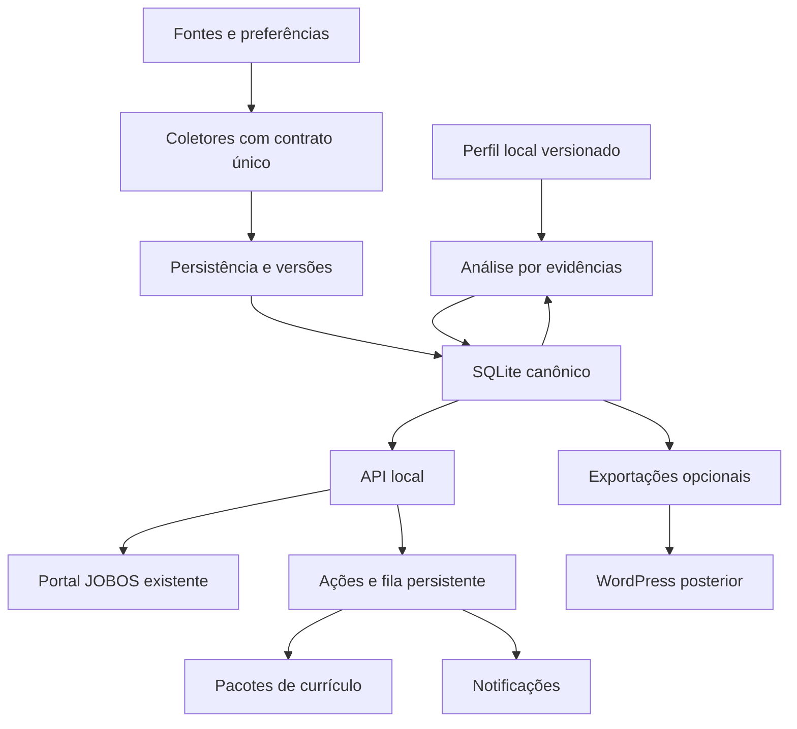
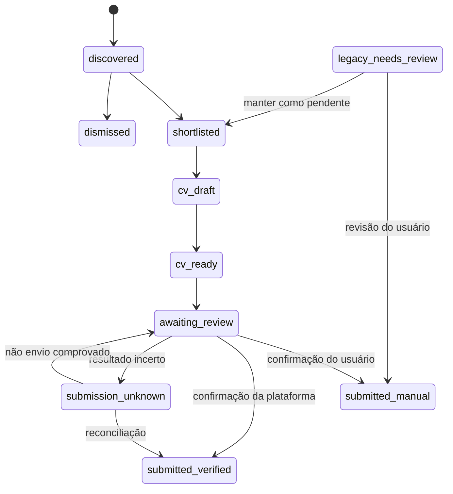

# Arquitetura e contratos do JOBOS

Os nomes abaixo são a especificação proposta. Claude deve adaptar nomes ao código existente somente quando isso evitar duplicação ou preservar compatibilidade, registrando a equivalência em `docs/DECISIONS.md`. Regras de dados e rastreabilidade não podem ser removidas por conveniência.

## 1. Autoridade por assunto

| Assunto | Autoridade | Derivados |
|---|---|---|
| Fatos da carreira | `config/profile/master.json`, versionado por hash | Projeção para matching, índice de evidências, payload de CV |
| Preferências de busca | `config/preferences.yaml` | Filtros do painel e política de priorização |
| Empresas e fontes | `config/sources.yaml` | Cache no banco e relatórios de cobertura |
| Estado operacional | `data/jobos.sqlite3` | API, painel, relatórios e exportações |
| Texto de anúncio observado | Snapshot original + versão normalizada | Extração de requisitos e hash de conteúdo |
| Arquivo enviado | Pacote imutável referenciado na candidatura | Registro de auditoria e follow-up |
| Credenciais | Ambiente do processo ou cofre local do Windows | Nunca duplicadas em JSONs públicos, logs ou exemplos |
| Estágio seletivo | Histórico de eventos confirmados do usuário/plataforma | Kanban e métricas |

O JSON remoto `https://rvalle.com.br/rafael.json` é referência de atualização, não dependência para cada execução. Guardar origem, data e hash de versões baixadas. Versão remota divergente entra como candidata comparável; não substitui fatos locais silenciosamente. Arquivo inválido não apaga o último perfil válido.

## 2. Estrutura proposta

```text
_system/
  _blueprint/                  documentos deste pacote, sem execução
  CLAUDE.md                    regras curtas, específicas e comandos reais
  README.md                    inicialização, uso e limitações comprovadas
  pyproject.toml
  requirements.lock            lock reproduzível gerado pela ferramenta escolhida
  .env.example                 somente nomes e placeholders não secretos
  .gitignore
  config/
    app.yaml
    sources.yaml
    preferences.yaml
    matching.yaml
    notifications.yaml
    profile/
      master.json
  src/jobos/
    __init__.py
    __main__.py
    cli.py
    settings.py
    paths.py
    pipeline.py
    domain/                    modelos e estados de negócio
    storage/                   conexão, repositórios, migrações e backup
    collectors/                leitores reaproveitados e bridge TS
    enrichment/                descrição e requisitos
    matching/                  evidências, política e IA opcional
    documents/                 geração JSON, claims e renderização
    applications/              preparação, eventos e ATS assistido
    notifications/             outbox, preview e transporte
    api/                       app, rotas e montagem estática permitida
    exports/                   portal antigo e WordPress, separados
  adapters/typescript/         somente bridge e suporte TS necessário
  schemas/                     contratos efetivamente validados
  web/                         componentes locais novos, se necessários
  scripts/windows/             bootstrap, executar, agendar e diagnosticar
  docs/                        auditoria, decisões, operação e progresso
  tests/                       fixtures e verificações de comportamento
  data/
    jobos.sqlite3
    imports/                   cópias identificadas e relatórios de migração
    raw/                       observações originais com retenção configurável
    profile-versions/
    exports/                   exportações locais, não públicas por padrão
    outbox-preview/
    artifacts/                 currículos e pacotes por candidatura
    backups/
    logs/
    browser/                   sessões ATS separadas do navegador pessoal
  .venv/
```

Criar módulos conforme a fase exigir. Não criar dezenas de arquivos vazios só para parecer modular. `_blueprint` é planejamento; `docs/PROGRESS.md` é estado real da implementação.

Os assets atuais em `__VAGAS/assets` podem ser servidos por uma montagem explícita somente desse diretório, depois de verificar seu conteúdo. A API não deve montar `__VAGAS` nem `_system` inteiros como raiz estática. Bibliotecas e arquivos privados não ficam acessíveis por coincidência de extensão `.json` ou `.html`.

## 3. Topologia e fronteiras



Não manter dois processos gravando o mesmo arquivo JSON ou SQLite por caminhos de negócio diferentes. Scheduler, CLI e API chamam o mesmo serviço de aplicação. O painel não grava no banco por SQL enviado pelo navegador.

## 4. Banco: entidades e fases

Preferir `sqlite3` da biblioteca padrão na consolidação inicial, pois o legado já o usa. Uma migração para ORM não é requisito. Cada conexão deve configurar foreign keys, timeout de espera e política de transação. WAL pode ser usado no disco local, com teste de concorrência. Não sincronizar banco WAL ativo com nuvem ou WordPress.

| Entidade | Campos-chave | Criar em |
|---|---|---|
| `schema_migrations` | versão, hash, aplicada_em | P1 |
| `imports` | import_id, origem, SHA-256, contagens, resultado | P1 |
| `legacy_id_map` | origem, legacy_id, canonical_job_id, regra | P1 |
| `companies` | company_id, nome, aliases controlados | P1 |
| `source_registry_versions` | hash do cadastro, conteúdo, data | P1 |
| `job_records` | UUID, empresa, título atual, estado agregado | P1 |
| `source_postings` | fonte, tenant, external_id, URL canônica, job_id | P1 |
| `job_versions` | job_id, hash, payload, observação, completude | P2 |
| `job_events` | tipo, instante, origem, payload, correlation_id | P1 |
| `runs` | run_id, trigger, início/fim, etapa, estado, contagens | P1 |
| `source_runs` | run_id, fonte, estado, páginas, volume, erro | P2 |
| `profile_versions` | profile_id, hash, origem, conteúdo, recebido_em | P1 |
| `analyses` | versão da vaga/perfil/política, resultado, cobertura | P4 |
| `requirements` | analysis_id, trecho, classificação, status, evidências | P4 |
| `applications` | application_id, job_id, preparação, envio, estágio | P1/P3 |
| `application_events` | evento, origem, instante, prova, registro anterior | P3 |
| `artifacts` | caminho relativo autorizado, SHA-256, tipo, versões | P6 |
| `notification_outbox` | chave dedupe, payload, tentativas, estado | P5 |
| `work_items` | tipo, alvo, status, lease, dedupe_key, erro | P3 |

É permitido reduzir tabelas físicas enquanto a semântica se mantém clara e testável. Não armazenar todos os eventos mutáveis em um único campo JSON sem validação. Não manter a tabela antiga `jobs` e `job_records` como duas autoridades graváveis.

Migração preferida: nova base canônica, importando a base legada em modo leitura. O banco antigo permanece intacto no diretório de importação, identificado por hash. Eventos antigos recebem referência de origem e datas originais, sem fingir que surgiram no momento da migração.

## 5. Identidade, deduplicação e republicação

Identidade forte por anúncio: `(source_platform, tenant_or_board, external_job_id)`. Todos os valores podem ser texto. O UUID canônico é interno e persistente.

Fallback: URL canônica validada, preservando parâmetros ou fragmentos que identificam a vaga. Remover somente parâmetros de rastreamento conhecidos, por exemplo `utm_*`; não remover todos os parâmetros indiscriminadamente.

O hash legado de empresa + título + primeiros caracteres da localização é evidência fraca. Duas vagas com o mesmo título podem ter IDs diferentes e ser contratações distintas. Uma vaga pode mudar de título preservando seu ID. Portanto:

- Mesmo ID de fonte com título novo: nova versão, não nova vaga.
- Novo ID com mesmo título: nova referência; sugerir relação `possible_repost`.
- URL da empresa compartilhada pelo agregador: pode justificar vínculo forte depois de normalização.
- Texto parecido sozinho: possível duplicata para revisão; nunca fundir candidaturas automaticamente.
- Origem perdida no banco antigo: registrar incerteza; não reconstruir IDs adivinhando.

Deduplicação de alertas é separada da deduplicação de anúncios. Um novo ID relacionado pode merecer aviso de republicação, sem sugerir candidatura duplicada.

## 6. Contrato de fonte

Exemplo ilustrativo do cadastro. Tenant/URL vieram do JSON anexado; capacidade atual precisa de smoke test.

```yaml
schema_version: 1
sources:
  - source_id: prio-gupy
    company_id: prio
    company_name: PRIO
    platform: gupy
    board_url: https://prio.gupy.io/
    tenant: prio
    enabled: true
    primary_adapter: python_gupy
    fallback_adapters: []
    ownership: discovery_only
    pagination_required: true
    configuration_origin: imported_jobs_json
    verification_status: needs_current_probe
    limits:
      timeout_seconds: 25
      max_attempts: 3
      max_concurrency: 1
```

`python_gupy` é um ID proposto de adapter, não uma função presumida existente. A matriz de P0 decide se o leitor Python ou TS será principal. URLs de exemplo não garantem que a estrutura pública continue igual.

Cada adapter retorna um `SourceBatch` validado:

```json
{
  "schema_version": 1,
  "run_id": "uuid-da-execucao",
  "source_id": "prio-gupy",
  "started_at": "2026-10-22T11:00:00Z",
  "finished_at": "2026-10-22T11:00:12Z",
  "status": "complete",
  "complete": true,
  "is_baseline": false,
  "scope_id": "hash-do-escopo-da-fonte",
  "coverage_kind": "full_board",
  "can_infer_absence": true,
  "pages_expected": 1,
  "pages_received": 1,
  "raw_count": 0,
  "normalized_count": 0,
  "adapter_version": "versao-real-do-codigo",
  "jobs": [],
  "warnings": [],
  "error_code": null,
  "error_message": null
}
```

O payload acima demonstra uma fonte reconhecida com retorno vazio e completo; não é resultado atual da PRIO. `can_infer_absence=true` apenas permite avaliar a política de confirmação, não encerra vagas imediatamente.

Estados permitidos: `complete`, `partial`, `failed`, `blocked`, `unconfigured`, `skipped`. Zero registros só é `complete` se o formato foi reconhecido e a paginação terminou. `complete=false` proíbe inferir encerramento por ausência.

`scope_id` identifica filtros/tenant/paginação usados. `coverage_kind` distingue `full_board`, `filtered_board`, `incremental_query` e `single_posting`. Uma query dos últimos três dias pode estar completa dentro de seu escopo e ainda assim nunca autorizar fechamento de vagas mais antigas. Alteração de filtro invalida comparações de ausência com o escopo anterior. Para novas fontes, registrar baseline antes de alertar todo estoque como novidade.

Coletor não envia e-mail, não altera candidatura, não pontua e não grava diretamente no banco canônico. Conteúdo de anúncios é dado externo não confiável; não executar instruções nele nem permitir que controle ferramentas ou prompts de sistema.

## 7. Contrato de vaga e datas

Campos mínimos: `company_id`, `source_id`, `external_id` quando existir, `title`, `url`, `observed_at`, `raw_payload_ref`, `description_status`, `location`, `workplace`, `published_at`, `published_date_precision`, `published_date_source`.

Separar:

| Campo | Regra |
|---|---|
| `published_at` | Publicação informada pela fonte; nulo quando não confirmada |
| `published_date_precision` | timestamp, date_only, relative_estimate ou unknown |
| `first_seen_at` | Primeira observação conhecida, imutável |
| `last_seen_at` | Última observação efetiva deste anúncio |
| `imported_at` | Momento de importação, nunca data de publicação |
| `source_updated_at` | Atualização da plataforma, não republicação automática |
| `content_changed_at` | Instante em que a mudança relevante foi observada |

Importar `~YYYY-MM-DD` como detecção estimada com texto original, não como publicação confirmada. `N/A`, vazio e textos não interpretados permanecem desconhecidos. Datas só com dia não recebem hora inventada apresentada ao usuário. Guardar o valor original e a regra de interpretação.

Se o histórico não informa primeira observação, não preencher `first_seen_at` com `imported_at` fingindo observação antiga. Pode permanecer nulo até uma observação real, mantendo `is_baseline` e procedência para não gerar alerta indevido. Se houver data de detecção histórica sem hora, preservar essa precisão em campo/metadata próprio.

Datas internas com instante são timezone-aware em UTC. Para exibição e janelas diárias usar `ZoneInfo('America/Sao_Paulo')`; instalar `tzdata` quando necessário no Windows. Não usar `date.today()` para definir dia brasileiro em processos que podem executar em UTC. Não subtrair três horas manualmente.

Hash de conteúdo inclui título, descrição significativa, requisitos, local, regime, salário e prazo quando houver. Exclui timestamps de coleta, ordem de cards, HTML de cookie e parâmetros de rastreamento. Guardar versões de normalização para explicar mudanças geradas por upgrade do parser.

## 8. Três eixos de estado

Não usar uma única coluna para misturar anúncio, ação de candidatura e processo seletivo.

| Eixo | Exemplos de estado |
|---|---|
| Anúncio | active, missing_unconfirmed, closed_confirmed, unknown |
| Preparação/envio | discovered, shortlisted, cv_draft, cv_ready, awaiting_review, submission_unknown, submitted_manual, submitted_verified, legacy_needs_review, dismissed |
| Processo seletivo | none, screening, test, interview, offer, rejected, withdrawn, hired |

O usuário pode confirmar envio manual, registrando data e fonte `user_asserted`. Isso não é prova automática da plataforma. Se houver comprovante verificável, usar `platform_confirmation`. Guardar ambos sem exigir captura de tela para um registro manual simples.

Tentativas de envio têm identificador próprio e chave idempotente. Mesmo job pode ter histórico de tentativas/reaplicação autorizada sem duplicar silenciosamente uma candidatura ativa. Follow-up nasce de envio confirmado ou afirmado pelo usuário, não da data de sugestão.



Nenhuma transição para enviada ocorre por e-mail de sugestão, visita à vaga, clique em abrir, currículo gerado ou passagem do tempo. `job.closed_confirmed` nunca apaga candidatura ou retrocede entrevista.

## 9. Evidências e análise

O perfil completo possui 32 módulos de topo no anexo inspecionado. Há status como `strong/proven`, `used/proven`, `developing`, `personal-project`, `listed-needs-context` e `do-not-claim`. Não reduzir tudo a uma lista plana de palavras.

Índice de evidências deve guardar: ID estável, JSON Pointer, versão/hash do perfil, trecho, status, contexto, período, entidades associadas, qualificador obrigatório e restrições. Um JSON Pointer precisa resolver de verdade no perfil utilizado.

Exemplos de caminhos presentes nos anexos:

- `/experience_nodes/exp_vanoord/period`
- `/software_systems_tree/corporate_operational_systems/sw_drake`
- `/certification_training_tree/cbsp`
- `/education_tree/edu_civil`
- `/truth_boundaries`

Análise proposta:

```json
{
  "schema_version": 1,
  "job_version_id": "versao-da-vaga",
  "profile_version_id": "hash-do-perfil",
  "policy_version": "matching-v1",
  "method": "deterministic",
  "decision": "needs_review",
  "fit_score": null,
  "coverage": 0.4,
  "confidence": "low",
  "requirements": [
    {
      "requirement_id": "req-1",
      "text": "Texto literal extraído do requisito",
      "importance": "mandatory",
      "requirement_source": "description:responsibilities",
      "status": "unknown",
      "evidence_refs": [],
      "explanation": "Sem evidência suficiente no perfil."
    }
  ],
  "strengths": [],
  "gaps": [],
  "unknowns": ["Exemplo de dado que exige revisão."],
  "next_action": "Revisar requisitos obrigatórios."
}
```

Regras de pontuação iniciais propostas, configuráveis e sem pretensão estatística:

1. Obrigatório recebe peso maior que desejável; requisito ambíguo não dispara exclusão automática.
2. Atendido pode valer 1, parcial 0,5 e lacuna comprovada 0. Desconhecido não vale 0 nem 1.
3. Calcular cobertura pelo peso dos requisitos avaliáveis dividido pelo peso total extraído. Se requisitos nem puderem ser extraídos, cobertura zero e nota nula.
4. Mostrar nota numérica somente com cobertura suficiente, por exemplo 60% como valor inicial ajustável. Baixa cobertura deve aparecer mesmo quando a nota dos itens conhecidos é alta.
5. Uma lacuna obrigatória comprovada pode determinar `not_eligible` segundo o texto da vaga. Não compensar licença obrigatória ausente com palavras-chave.
6. Prioridade operacional combina decisão, preferências, idade conhecida e esforço de forma transparente. Empresa-alvo não aumenta domínio técnico.
7. `fit_score` nunca se chama probabilidade de aprovação, contratação ou entrevista.

Manter histórico das decisões e overrides humanos com motivo. Evitar reprodução automática de scores anteriores do perfil ou de `score.py` sem reanálise.

## 10. IA opcional

Interface `AnalysisProvider` com implementação determinística funcional e provider opcional para modelo local ou API já configurada. Não assumir que assinatura de Claude Code disponibiliza uma API de inferência gratuita para o engine diário.

Entrada do modelo: requisitos do anúncio como dados delimitados, recorte relevante do perfil, limites de verdade e esquema de saída. Saída validada por tipos e referências resolvíveis. IA não recebe chave SMTP nem acesso a browser/arquivo por instruções de anúncios.

Cache por `(job_version_hash, profile_hash, policy_version, provider, model, prompt_version)`. Orçamento por execução, timeout, máximo de tentativas e fallback explícito. Rodar sem IA não inventa uma análise semântica equivalente; exibir método e limitações.

Modelo local depende de hardware e modelo instalado. Diagnosticar, não prometer qualidade/custo zero universal. Envio para API externa é opção configurável; perfil não é enviado por padrão para um serviço ainda não escolhido.

## 11. Claims e CV

Um claim é uma afirmação verificável, não apenas uma palavra encontrada em um corpus.

```json
{
  "claim_id": "claim-1",
  "text": "Texto do bullet proposto para o currículo.",
  "evidence_refs": ["/experience_nodes/exp_vanoord/formal_job_scope"],
  "profile_hash": "hash-real",
  "claim_kind": "professional_experience",
  "required_qualifiers": [],
  "validation": "needs_semantic_review"
}
```

Uma referência existente não prova automaticamente que o texto é sustentado. Verificar sujeito, ação, contexto, data, quantidade, unidade e nível de domínio. Um número encontrado em outra experiência não valida esse número no bullet atual.

O linter legado continua útil como heurística auxiliar, mas não como garantia de verdade. Toda afirmação gerada deve passar por validação de referências, limites e revisão semântica; se não puder ser validada, bloquear a versão final.

Pacote sugerido:

```text
data/artifacts/<job_uuid>/<artifact_version>/
  job-snapshot.json
  job-description.txt
  analysis.json
  claims.json
  cv.json
  cv.pdf
  answers.json
  validation.json
  manifest.json
```

Arquivos finais imutáveis. Nova geração cria nova versão, não sobrescreve PDF enviado. Manifesto registra SHA-256, caminhos relativos, perfil, anúncio, schema do Builder e renderizador. Reutilizar artefato se todas as entradas e hashes coincidirem.

## 12. API local proposta

| Método e rota | Comportamento |
|---|---|
| `GET /api/health` | Saúde do processo; não dispara coleta |
| `GET /api/status` | Estado do sistema, última execução e bloqueios |
| `GET /api/sources` | Saúde individual por fonte |
| `GET /api/jobs` | Paginação, busca e filtros validados |
| `GET /api/jobs/{id}` | Detalhes, versões e análise |
| `POST /api/work-items` | Enfileira coleta/análise/documentos permitidos |
| `GET /api/work-items/{id}` | Resultado e progresso |
| `GET /api/applications` | Histórico com procedência |
| `POST /api/applications/{id}/events` | Transição validada com origem e motivo |
| `GET /api/artifacts/{id}` | Metadados de artefato autorizado |
| `GET /api/artifacts/{id}/download` | Arquivo permitido, sem path arbitrário |
| `GET /api/notifications` | Estado da fila e previews |
| `GET /api/runs/{id}` | Execução e fontes da mesma execução |

Sem `POST` genérico que aceite caminho de shell ou URL arbitrária para execução. Validar extensões, hosts de fontes, tamanho de payload e caminhos resolvidos. Links externos só usam HTTP/HTTPS. HTML de anúncio é sanitizado ou mostrado como texto, nunca `innerHTML` direto.

Bind padrão em `127.0.0.1`. Restringir Host/Origin, negar CORS aberto e usar proteção de mutações contra chamadas de páginas externas. Loopback sozinho não é proteção contra CSRF/DNS rebinding. Não criar autenticação pesada para um usuário local, mas não expor mutações a qualquer site.

## 13. Concorrência, fila e falhas

- Uma trava de ciclo por instalação, válida entre processos. Preferir lock real do SO/biblioteca mantida ou lease robusto; PID sozinho não garante propriedade após reinício.
- `work_items` e outbox persistentes; estado atualizável por transações curtas e compare-and-set.
- IO de rede fora de transações SQLite longas. Commit de observações por lote validado.
- Workers não duplicam o mesmo item com lease ativo. Reboot recupera lease vencido sem repetir efeitos externos cegamente.
- Identificador de dedupe único por operação/versão. Evento e estado correspondente gravados na mesma transação.
- Cancelamento fecha run como interrompida e marca fonte incompleta, sem efeitos de ausência.
- Trava duplicada gera `skipped_overlap`, não falha de coleta e não novo boletim.
- Erro de uma fonte permite processar fontes bem-sucedidas. Resultado global fica parcial.
- Timeouts após envio externo geram estado desconhecido, que exige reconciliação antes de tentar de novo.

## 14. Outbox

Campos: `notification_id`, `idempotency_key`, `recipient_ref`, `channel`, `subject`, `payload_ref`, `created_at`, `attempts`, `next_attempt_at`, `status`, `last_error_code`, `provider_message_id` quando existir, `smtp_accepted_at`, `delivery_confirmed_at` quando houver.

Estados: draft, queued, sending, accepted, failed_transient, failed_permanent, unknown, cancelled. `accepted` significa aceito pelo serviço, não entregue na caixa de entrada.

Não existe garantia de exactly-once com SMTP comum: a conexão pode cair depois de o servidor aceitar. Dedupe e `Message-ID` estável reduzem duplicação, mas não a eliminam. Em resultado ambíguo, mostrar aviso e reconciliar, não afirmar garantia absoluta.

## 15. Exportações e privacidade operacional

Portal antigo: emitir `companies[].jobs[]`, `updatedAt` para mudanças de conteúdo e `checkedAt` para coleta. Plugin WordPress: emitir `vagas[]` e versão de schema compatível, com controle por empresa e completude.

Exportação pública usa allowlist: título, empresa, localização pública, URL e publicação confirmada. Excluir score pessoal, candidato, CV, estágio, notas, e-mail e respostas. Exportação privada pode incluir mais campos somente no destino configurado.

Nunca copiar `_system` inteiro para hospedagem. Excluir DB, WAL, SHM, `.venv`, `.env`, perfil completo, browser state, artefatos, backups e logs das rotinas de publicação. Backup consistente não deve ser confundido com sincronização contínua do banco ativo.
